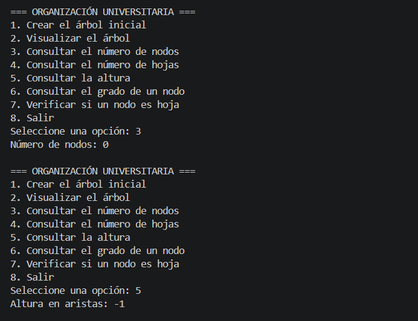
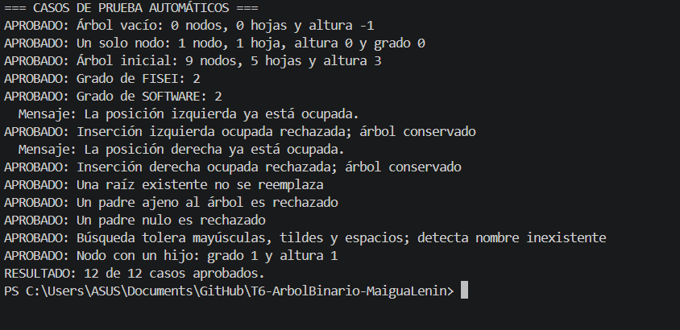
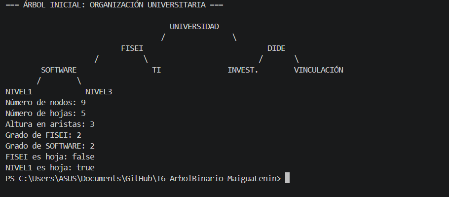
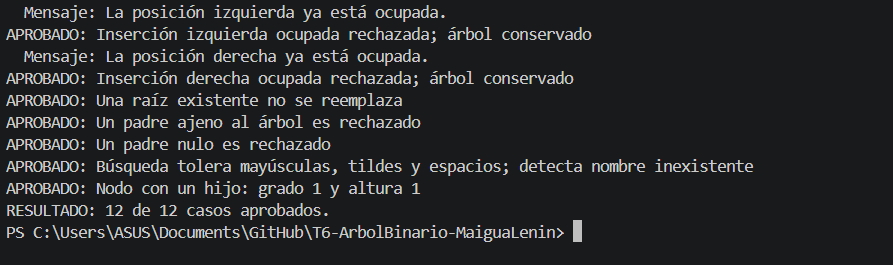
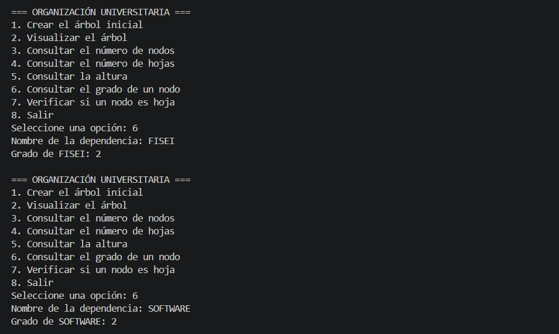
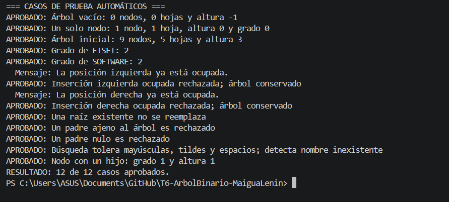

# T6-ArbolBinario-MaiguaLenin

**Asignatura:** Estructura de Datos | **Nivel:** Tercero – Ingeniería de Software  
**Estudiante:** Maigua Shigui Lenin Alexander

## 1. Problema

La Universidad necesita representar la organización de sus dependencias académicas mediante un árbol binario. Cada nodo almacena el nombre de una dependencia y tiene como máximo dos hijos.

El programa permite construir el árbol, visualizarlo y consultar el número de nodos, las hojas, la altura, el grado de un nodo y si un nodo es hoja. Está desarrollado en Java mediante programación orientada a objetos. Los conteos y la altura se calculan con recursividad.

## 2. Estructura del árbol

```text
                  UNIVERSIDAD
                 /           \
             FISEI            DIDE
            /     \          /    \
       SOFTWARE    TI   INVEST.  VINCULACIÓN
        /    \
     NIVEL1  NIVEL3
```

- **Nodos:** 9.
- **Hojas:** 5: NIVEL1, NIVEL3, TI, INVEST. y VINCULACIÓN.
- **Altura:** 3 aristas. Uno de los caminos más largos es UNIVERSIDAD → FISEI → SOFTWARE → NIVEL1.

```text
src/
├── modelo/
│   └── Nodo.java
├── negocio/
│   └── ArbolBinario.java
└── app/
    └── Main.java
```

**Nodo<T>:** guarda el dato y las referencias a los hijos izquierdo y derecho. Incluye constructor, getters, setters, `esHoja()` y `grado()`.

**ArbolBinario<T>:** crea la raíz, agrega hijos, cuenta nodos y hojas, calcula la altura y muestra el árbol de arriba abajo, con ramas `/` y `\`.

**Main:** contiene el menú interactivo con `Scanner`, la construcción inicial, las consultas y las pruebas automáticas.

No se utilizan TreeSet, TreeMap, PriorityQueue, NavigableSet ni NavigableMap.

## 3. Instrucciones de ejecución

**Requisito:** tener instalado el JDK 17 o superior. Abrir la carpeta del proyecto en Visual Studio Code y ejecutar los siguientes comandos desde la carpeta principal del repositorio:

```powershell
javac --release 17 -encoding UTF-8 -d bin src/modelo/Nodo.java src/negocio/ArbolBinario.java src/app/Main.java
java "-Dfile.encoding=UTF-8" -cp bin app.Main
```

El menú permite:

1. Crear el árbol inicial.
2. Visualizar el árbol.
3. Consultar el número de nodos.
4. Consultar el número de hojas.
5. Consultar la altura.
6. Consultar el grado de un nodo.
7. Verificar si un nodo es hoja.
8. Salir.

Para ver la demostración del árbol y sus consultas:

```powershell
java "-Dfile.encoding=UTF-8" -cp bin app.Main --demostracion
```

Para ejecutar las doce comprobaciones automáticas, que incluyen los cinco casos obligatorios:

```powershell
java "-Dfile.encoding=UTF-8" -cp bin app.Main --pruebas
```

Usar una fuente monoespaciada y una terminal de al menos 76 columnas para conservar la alineación del árbol inicial.

## 4. Resultados

### Caso 1: árbol vacío

Antes de crear el árbol, las opciones 3 y 5 muestran **0 nodos y altura -1**. La captura corresponde a la secuencia de opciones 3, 5 y 8.



### Caso 2: árbol con un solo nodo

La prueba automática crea únicamente la raíz y comprueba **1 nodo, 1 hoja, altura 0 y grado 0**. La captura muestra el resultado de esta comprobación dentro de `--pruebas`.



### Caso 3: árbol inicial

La demostración presenta el árbol de arriba abajo y confirma **9 nodos, 5 hojas y altura 3**.



### Caso 4: insertar un hijo en una posición ocupada

Las pruebas intentan agregar nuevos hijos a FISEI, cuyo lado izquierdo ya contiene SOFTWARE y cuyo lado derecho contiene TI. Ambos intentos se rechazan y se comprueba que el árbol conserva sus hijos originales y los resultados **9 nodos, 5 hojas y altura 3**.



### Caso 5: grado de FISEI y SOFTWARE

Después de crear el árbol con la opción 1, se utiliza la opción 6 para consultar FISEI y SOFTWARE. Ambos tienen **grado 2**, porque cada uno posee dos hijos.



### Pruebas completas

La ejecución de `--pruebas` termina con **12 de 12 casos aprobados**. También comprueba posiciones ocupadas en ambos lados, raíz existente, padres ajenos o nulos, búsqueda de nombres y un nodo con un hijo.



| Caso obligatorio | Resultado |
| --- | --- |
| Árbol vacío | 0 nodos y altura -1. |
| Un solo nodo | 1 hoja y altura 0. |
| Árbol inicial | 9 nodos, 5 hojas y altura 3. |
| Posición ocupada | Inserción rechazada y estructura conservada. |
| Grado de FISEI y SOFTWARE | 2 y 2. |

